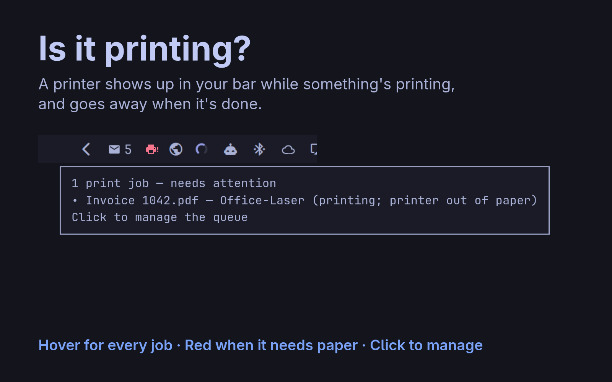
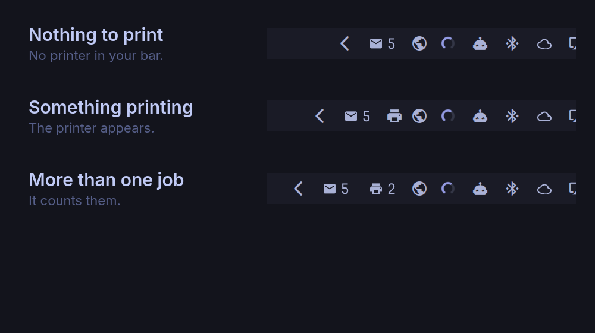
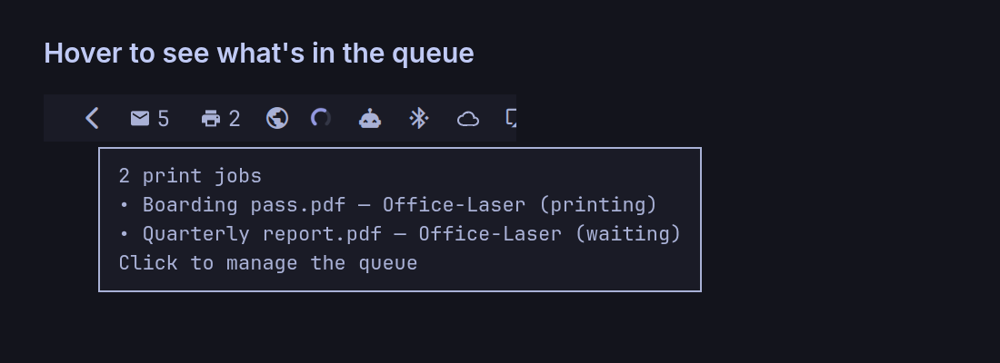
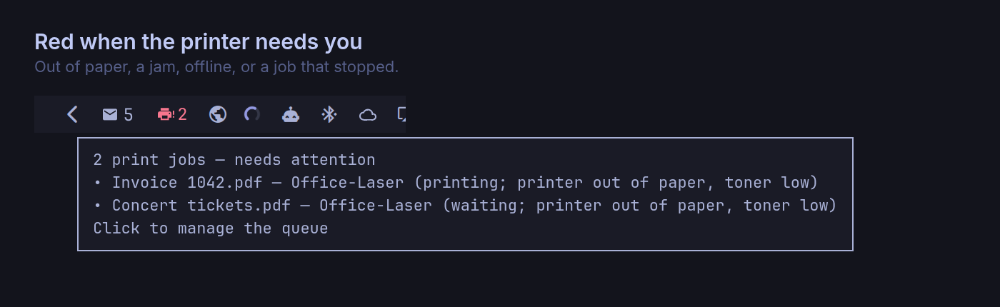

# Print Queue — an Omarchy bar widget

Is it printing? A printer shows up in your bar while something's printing or
waiting to print, and goes away when the queue is empty.



## What you get

You press Print and nothing happens. Is it printing, stuck, or waiting on a
printer at the other end of the house? Print Queue answers that from the bar,
and stays out of the way the rest of the time.

**Only there when it matters.** No printer icon sitting in your bar all day.
It appears when CUPS has a job that isn't finished, counts them when there's
more than one, and disappears when the last one is done.



**Hover to see what's in the queue.** Each job's name, which printer it's on,
and whether it's printing, waiting or held.



**Red when the printer needs you.** Out of paper, a paper jam, the printer
offline, or a job that stopped or failed: the icon turns red and the tooltip
says why, in plain words. A job you held on purpose (`lp -H hold`) doesn't
count as stuck.



**Click to manage it.** A click opens CUPS's own jobs page
(`http://localhost:631/jobs/`), where you can cancel, hold or release a job.

**Nearly free.** One small request to your local CUPS server every 5 seconds,
about 5 ms. There's no helper process, and nothing leaves the machine.

## Install

```bash
omarchy plugin add https://github.com/jonspinks/omarchy-printqueue --enable
```

`--enable` places it in the bar. `omarchy plugin enable blacksheep.printqueue --before omarchy.network`
puts it somewhere specific, and you can drag it along the bar afterwards. It
takes no space while the queue is empty.

## Remove

```bash
omarchy plugin remove blacksheep.printqueue
```

That takes it off the bar and deletes the plugin folder. It writes no files
and changes no settings, so there's nothing else to clean up.

## How it works

Every 5 seconds (every 2 while there are jobs) the widget runs
`ipptool -c ipp://localhost/ queue.test`, a fixed command with the query file
beside it. That asks the local CUPS server for every job not yet finished and
every printer's state, as CSV. `Model.js` turns the answer into the count, the
red state and the tooltip.

- CUPS hides the names of other users' jobs, so those show as "Job 12".
- Job names come from whatever app printed, so they're stripped of control
  characters, clipped to 60 characters and shown as plain text. At most 10
  jobs are listed, with "…and N more" after.
- If CUPS isn't running, the widget stays hidden.

## Settings

Set on the widget's entry in `~/.config/omarchy/shell.json`:

```json
{ "id": "blacksheep.printqueue", "interval": 5 }
```

| Key | Default | Meaning |
|---|---|---|
| `interval` | `5` | seconds between checks while the queue is empty (minimum 2) |

## Requirements

CUPS, for `ipptool`, with the `cups` service running; you already have both if
you print on Omarchy. `xdg-open` for the click. No privileges and no network
access beyond `localhost`.

## Tests

```bash
bash tests/run.sh
```

Node tests for the parsing and wording in `Model.js`, from real `ipptool`
output.

## License

MIT
